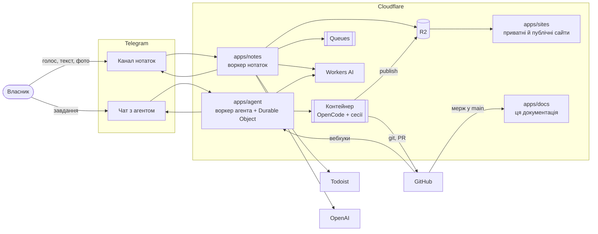
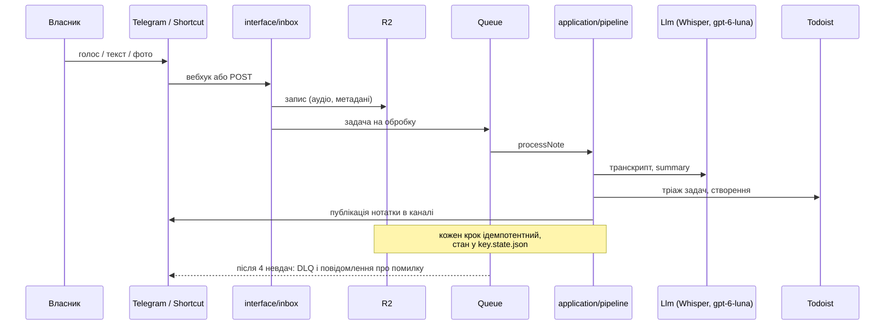
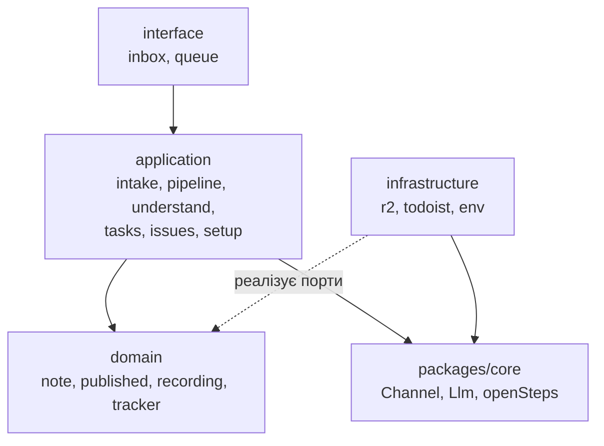
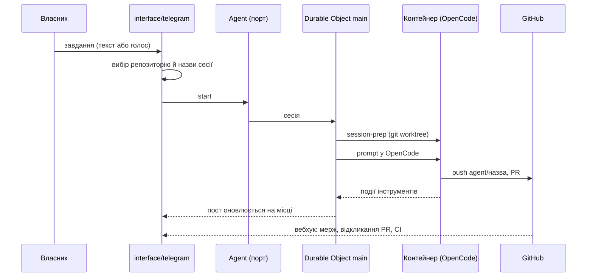
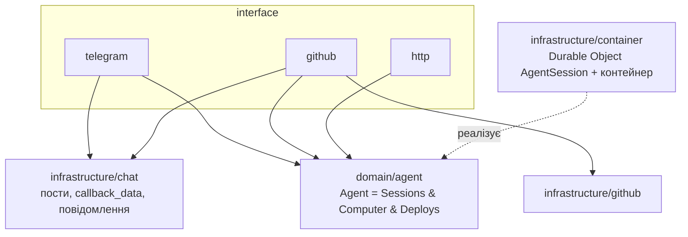
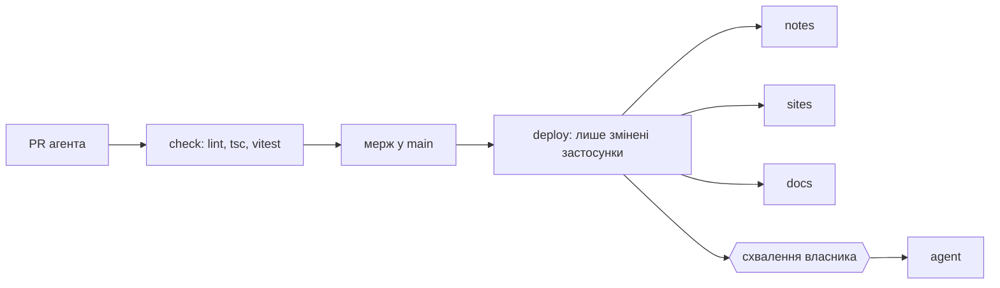

# Архітектура

Огляд системи з діаграмами. Ця сторінка першою відкривається на приватному сайті документації (`apps/docs`), який перебудовується після кожного мержу в `main`; діаграми тут пишемо в Mermaid. Змінив структуру чи потік даних: онови діаграму в тому ж PR.

## Загальна картина



Три воркери (`notes`, `agent`, `sites`) і спільний код у `packages/*`; застосунки не залежать один від одного. Документація (`docs`) — окремий воркер зі статикою, зібраною з цього репозиторію.

## Нотатки: конвеєр обробки запису



## Нотатки: шари



Ядро (`interface`, `application`, `domain`) не знає про Telegram і Todoist, лише про порти: `Channel`, `Llm`, `TaskTracker`, `NoteRepository`, `TaskLedger`, `RecordingStore`. Адаптери складаються в `src/index.ts`.

## Агент: від повідомлення до PR



## Агент: модулі



Interface-модулі не залежать один від одного (ADR 0004). Один Durable Object і один контейнер на всі сесії (ADR 0001).

## Сайти агента

```mermaid
flowchart LR
  a[Агент у контейнері] -- publish --> b1[(R2 agent-sites)]
  a -- publish --public --> b2[(R2 agent-sites-public)]
  b1 --> s[sites.домен<br/>Cloudflare Access]
  b2 --> p[share.домен<br/>без Access]
```

## CI/CD



Нижче на сторінці «Знімок коду» видно актуальну структуру модулів і прив'язки кожного воркера, згенеровані з репозиторію під час збірки.
